<p align="center"></p>

# Rolidium

**Direct-modeling CAD for mechanical parts.**
Push and pull faces instead of editing a feature tree, in the spirit of DesignSpark Mechanical and SpaceClaim. Today Rolidium models parts
and exports STL and STEP (3D printing, input for manufacturing); CAM for CNC machines (toolpaths for milling) and output for laser cutting will come later.
Written in Rust on the Open CASCADE geometry kernel, with an egui/wgpu interface. Free and open source under the AGPL-3.0.

Web: [rolidium.com](https://rolidium.com) · Support forum: [rolidium.com/forum](https://rolidium.com/forum) · Download: [rolidium.com/download](https://rolidium.com/download)

> **Status: alpha.** Rolidium is under active development and not ready for production work. Expect missing features, rough
> edges and changes to the file format. Keep copies of important models (STEP export is a good archive format).

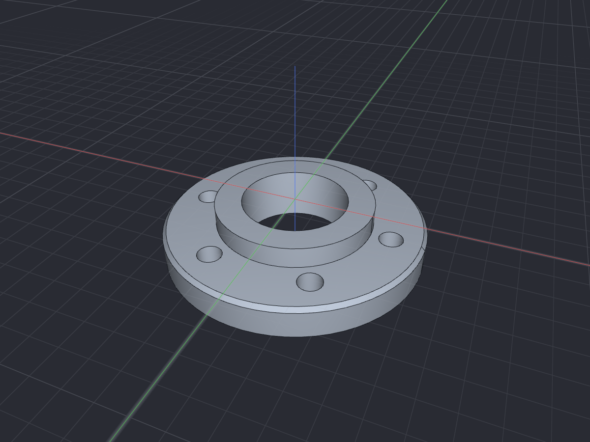

## Download and install

Packages for Linux and Windows and their SHA-256 checksums (`SHA256SUMS`) are on the [releases page](https://github.com/MrRolid/Rolidium/releases) and on [rolidium.com/download](https://rolidium.com/download).
Check the download against the checksums: `sha256sum -c SHA256SUMS` (Linux), `certutil -hashfile <file> SHA256` (Windows).

**Debian, Ubuntu, Linux Mint (the `.deb`)**

    sudo apt install ./rolidium_0.2.0_amd64.deb

This puts `rolidium` (and the links `rolidium-cli` and `rolidium-mcp`) into `/usr/bin`, adds a menu entry with its icons and makes `.rolidium`
files open in Rolidium. Remove it with `sudo apt remove rolidium`. In Cinnamon (Linux Mint) the icon in the menu may appear only after the panel is restarted (Alt+F2, `r`, Enter) or after you log in again.

**Any Linux (the `.AppImage`)**

    chmod +x Rolidium-0.2.0-x86_64.AppImage
    ./Rolidium-0.2.0-x86_64.AppImage

Without FUSE (some containers and minimal systems): `./Rolidium-0.2.0-x86_64.AppImage --appimage-extract-and-run`. The AppImage uses the libraries
of the system like the other Linux packages; nothing is installed.

**Any Linux (the `.tar.gz`)**

    tar xzf rolidium-0.2.0-linux-x86_64.tar.gz
    cd rolidium-0.2.0
    ./rolidium
    ./install-desktop-entry.sh      # optional: a menu entry and the icon for the current user, no root needed

**Windows**

Unpack `rolidium-0.2.0-windows-x86_64.zip` into a folder you choose and start `rolidium.exe`. There is no installer and nothing is written
outside the folder, except the settings (`%APPDATA%\rolidium`) and the log and autosave (`%LOCALAPPDATA%\rolidium`).

**Minimum requirements**

* Windows 10 or 11, 64-bit.
* Linux x86-64 with **glibc 2.35 or newer** and libstdc++ 12 or newer: Ubuntu 22.04 and later, Debian 12 and later, Linux Mint 21 and later, Fedora 36 and later. Older systems (Debian 11, Ubuntu 20.04, RHEL 9) do not run it.
* A graphics card with DirectX 12 (Windows), Vulkan or OpenGL 3.3 (Linux), and its driver. Without one, Rolidium draws by software, which works but is slow.
* Memory: a small model needs little; a document with hundreds of bodies needs hundreds of MB (the router demo: about 400 MB).

**A new, unsigned program.** Rolidium is new and its Windows program is not signed with a certificate. Windows SmartScreen may say "Windows protected your PC"
(choose *More info*, then *Run anyway*), and some antivirus programs may block or quarantine `rolidium.exe` as unknown. It is a false alarm: the
program is open source, you can check the download against the SHA-256 checksums, and you can build it yourself ([BUILDING.md](BUILDING.md)). Add the folder of
Rolidium (or the file) to the exceptions of your antivirus (in Windows Security: *Virus & threat protection* > *Manage settings* > *Exclusions* > *Add or remove exclusions*).
If your antivirus vendor lets you report a false positive, please do; the details for that are in the release.

To build the program yourself, see [BUILDING.md](BUILDING.md).

## What it looks like

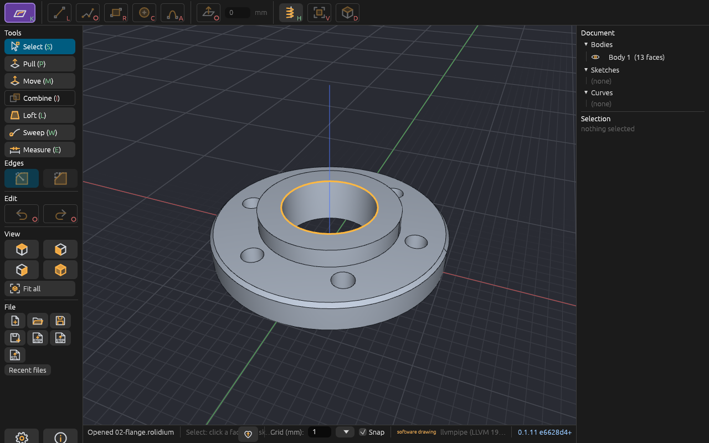

| Helix with a live preview | Sketch plane named in the view |
| --- | --- |
| 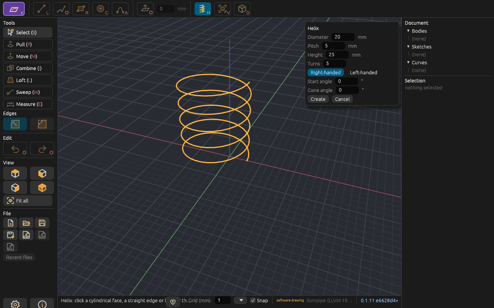 | 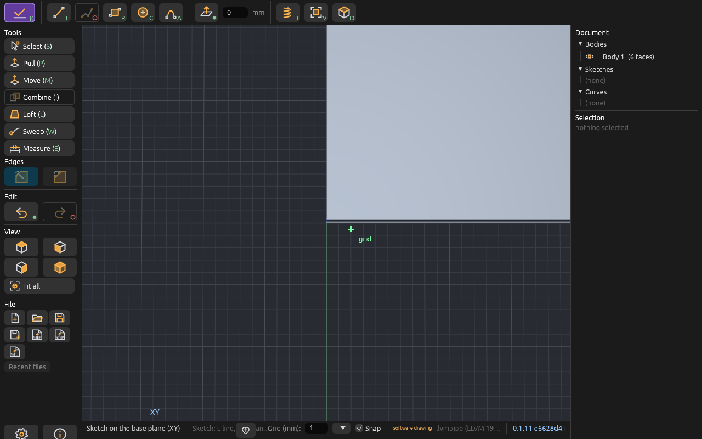 |

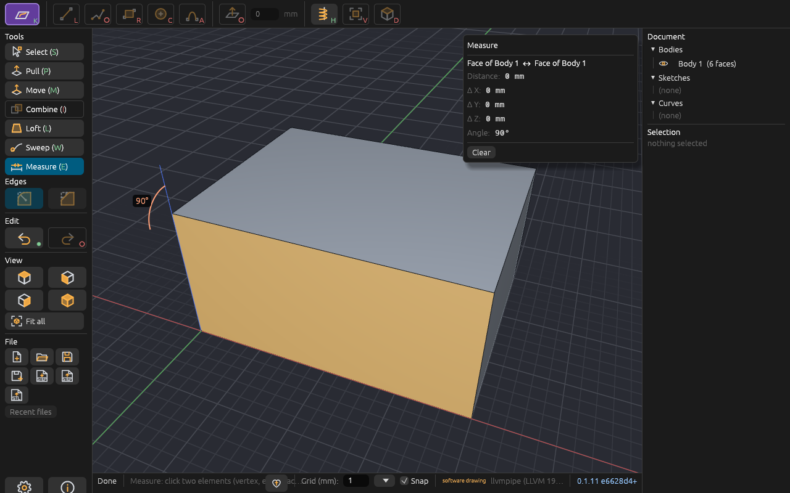

## Example parts

Ten bigger models, from an electronics box to a gantry CNC router with 338 bodies, are in [`examples/demos`](examples/demos/) (public domain, CC0 1.0, while the rest of the repository is AGPL-3.0-only).

Every part below is built by a short script for the headless tool, see [`examples/`](examples). The scripts run in the test suite
and check the volume of the result, so they stay correct.

| | | |
| --- | --- | --- |
| 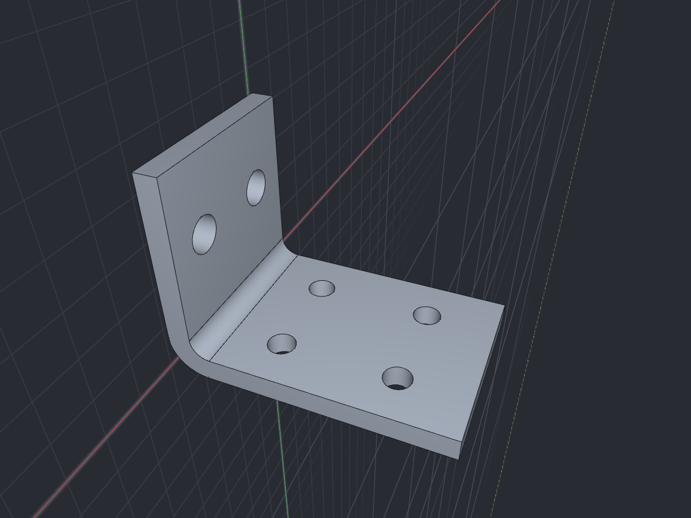 |  | 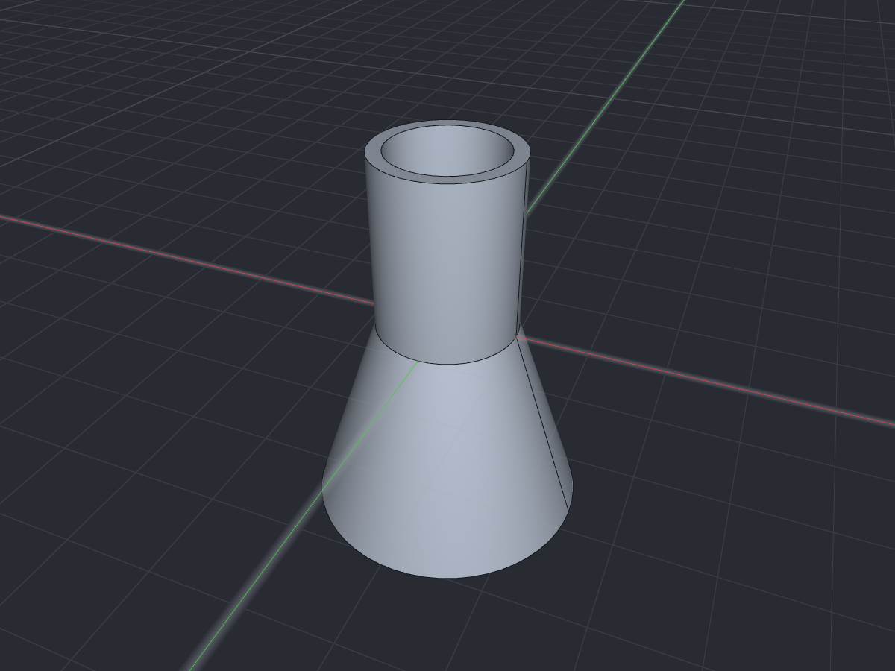 |
| L-bracket with holes and rounded bends | Flange with bolt circle, hub and chamfer | Funnel: ruled loft between two rings |
| 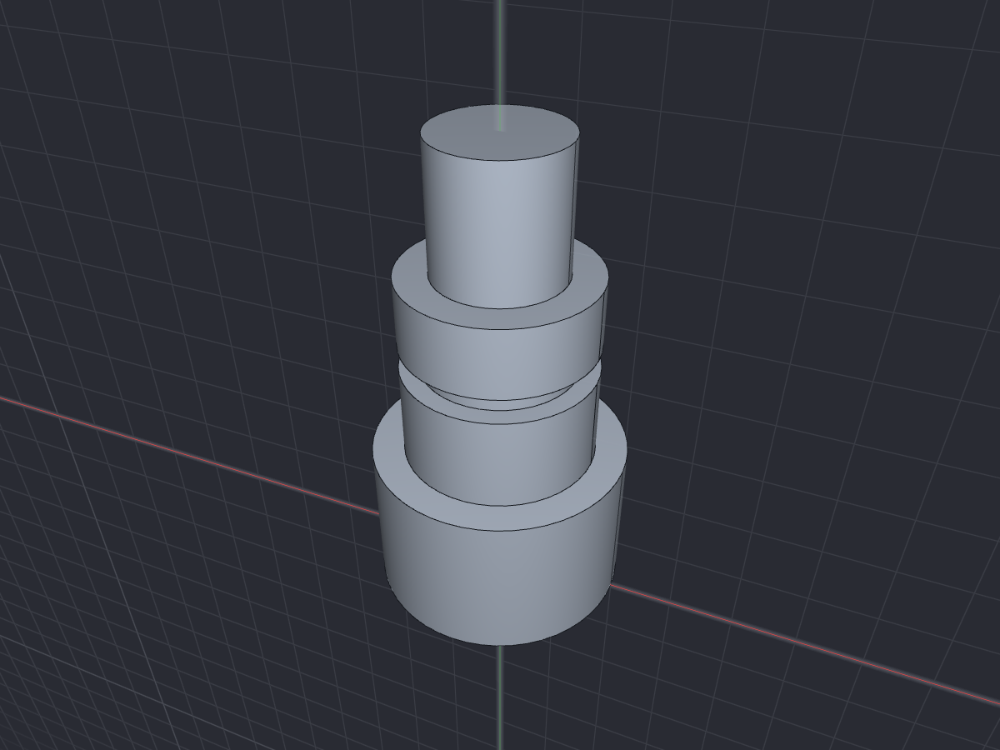 | 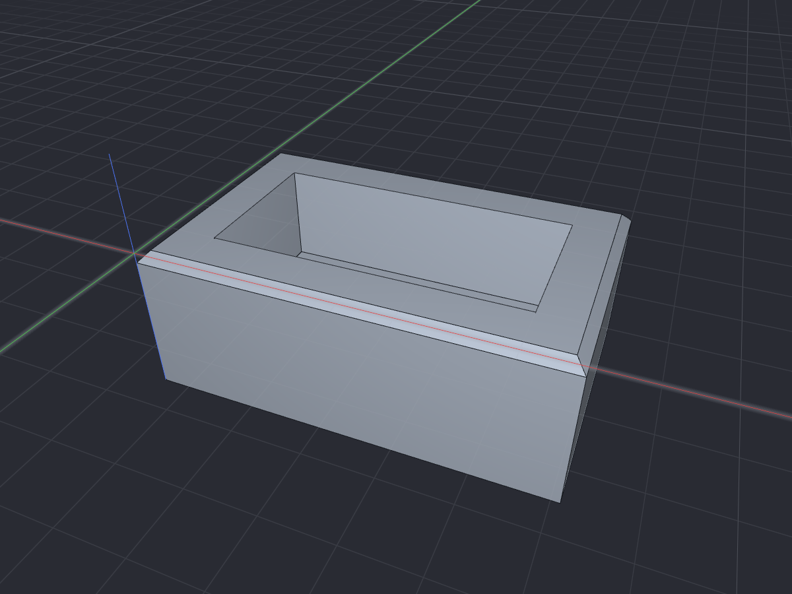 | 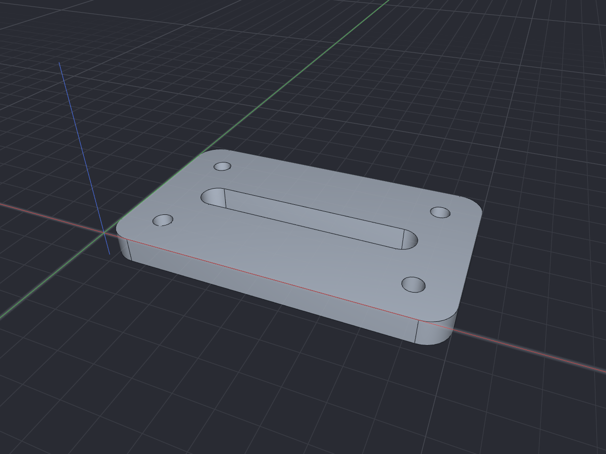 |
| Turned part: revolved profile with a groove | Box with chamfered edges and a pocket | Plate with a slot made of arcs, rounded corners, holes |
| 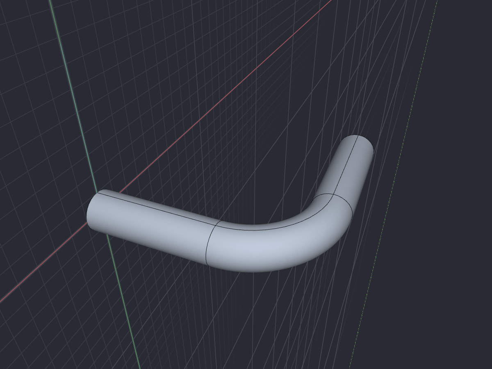 | 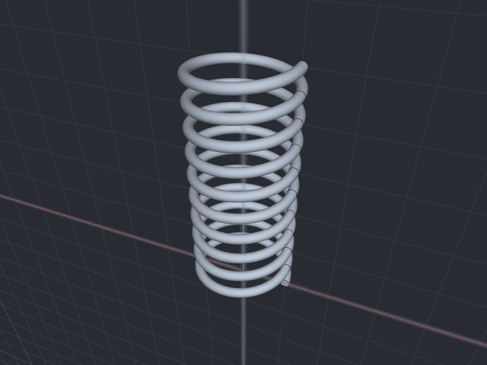 | 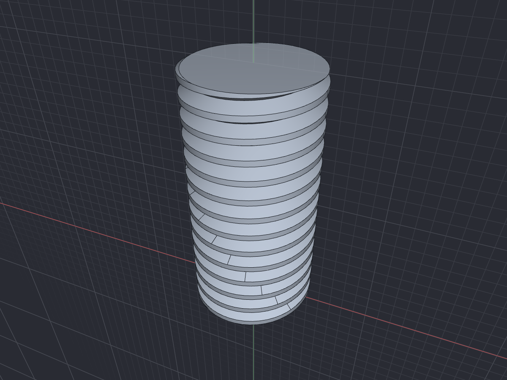 |
| Hollow tube swept along a line, an arc and a line | Spring: a circle swept along a helix | External thread M10 x 1.5: a V profile swept along a helix and cut from a cylinder |

## Features

Everything listed here works today.

**Modelling**
* Pull and push faces and sketch regions with the mouse or a typed distance; add, cut or automatic mode; pull *up to* a vertex, edge or face.
* Move and rotate bodies, also as a copy.
* Combine bodies: merge, cut, intersect. Every result is checked against an independent volume calculation, and a result that does not add up is refused.
* A new volume that touches or overlaps a body joins it (a body of its own only when it touches nothing); cut mode takes it out of the bodies it overlaps.
* **Fill** (`F`): the closed flat loop an edge belongs to (the edge of a hole, the inner circle of a pipe), or sketch lines or a 3D line, becomes
  a region with the exact geometry (a circle stays a circle) and Pull starts with it: close a hole or make a plug.
* **Join ends** (`J`): connects open lines, arcs and 3D lines whose ends are closer than a chosen gap, from the closest pairs; tiny gaps are
  welded, larger ones get a line; live dashed preview, one step of Undo.
* Revolve a profile about an axis.
* Loft between two or more profiles (sketch regions, flat faces or circular edges), ruled or smooth, with rings and holes; a ruled loft
  between coaxial circles is a real cone.
* Sweep a profile along a path: a 3D line, a helix, a chain of sketch lines and arcs or a chain of edges; hollow profiles (pipes), sharp or rounded corners,
  Add / Cut / New body. Threads and springs come from a helix; results are checked and a self-intersecting sweep is refused.
* 3D lines (points that snap to vertices, edge midpoints, circle centres and points of sketches; X, Y, Z locks, typed length, corner radius) and helices
  (axis from a cylindrical face, a straight edge or a point; pitch, height or turns, handedness, start and cone angle) as curves of the document.
* Round and chamfer edges (also symmetric or with an angle and a side), whole smooth chains (also the pieces of a loft outline), concave edges;
  every result is checked and a damaged one is refused with a clear message that names the largest size that still works; change the size later or bring the sharp edge back.
* Measure: pick two elements (vertex, sketch or curve point, edge, face); distance with its X, Y, Z parts, angles, the distance of parallel faces or cylinder axes,
  with dimension lines in the view. Ctrl+click takes a point (middle of an edge, centre of a circle).
* Mass of a body for a chosen material (steel, aluminium, brass, copper, PLA, PETG, ABS or your own density).
* Long calculations run in the background and can be cancelled with the Cancel button or Esc; the model stays exactly as it was.

**Sketching**
* Line, rectangle, circle and arc (including arcs that continue a line or arc tangentially), with typed dimensions.
* Snapping to the grid, endpoints, midpoints, centres, extensions, perpendiculars and 3D points of the model, with guides that show why.
* Sketch on a base plane, on a flat face, on the plane tangent to a curved face, or on a plane moved along its normal (drag, type a distance or pull it *up to* a vertex or face).
* Closed regions are found automatically, including regions with holes.
* The view turns square to the sketch plane and back (animated; can be switched off); the plane is named in the view (XY, XZ, YZ with its offset, or Face).

**Files**
* Native `.rolidium` documents (a zip archive; format described in [`docs/FILE-FORMAT.md`](docs/FILE-FORMAT.md)) with atomic saving,
  automatic recovery after a crash and recent files.
* STEP import and export, binary or ASCII STL export with fineness presets and a live size estimate.
* A built-in file dialog with places, mounted disks, a folder tree, sortable columns, a typed path with completion and a filter.

**Interface**
* The Selection panel shows volume, surface area, mass and size of a body, area and diameter of faces, length and radius of edges (sums for several); a click copies a value.
* Undo and redo of everything, a document tree, hide and show, rename, delete. **Every body has a name** (free text, shown in the list and in the Selection panel; rename it with `F2` or a double click, one step of Undo). The name is saved in the file, kept by operations (a copy has the same name, a merged body keeps the name of its target), given with `name "..."` in `rolidium cli` and MCP, and written to and read from STEP files. The list of bodies scrolls, and follows what you pick in the model.
* **Smooth display.** A circle or a hole stays round when you zoom in: the faces in view are meshed again in the background for the pixel at their own distance, with a budget of triangles shared by the bodies in view (a hole of 6 mm in a plate of a document of 300 bodies is within half a pixel of the exact circle).
* **Fast in big documents.** An operation, Undo or Redo costs what the changed bodies cost, not what the document costs: the router demo (338 bodies) moves a screw in about 25 ms and pulls a face of a small body in about 60 ms (measured under load, see [docs/PERFORMANCE.md](docs/PERFORMANCE.md)). The meshes of the bodies, the reading of a file and the booleans use several cores (below).
* **Demo models:** ten models from an electronics box to a CNC router with 338 bodies in [`examples/demos`](examples/demos/) (public domain, CC0 1.0).
* Buttons show with a traffic light whether they can be used now and why not; Sketch is the main button (it becomes "Finish sketch").
* Dark (default) or light appearance, or follow the system; a toolbar above the view and floating panels you can drag away from the model.
* Interface in English, Czech, German, Spanish, French and Japanese; more languages by adding a text file. Icons and a help card for every tool.
* Graphics: a real graphics card is preferred over software drawing, the backend (auto, dx12, vulkan, gl) can be chosen in Settings or with `--backend`,
  and *About > Save diagnostics* (or `rolidium --diagnose`) writes a zip with the adapters, the log and test pictures for a bug report (no personal paths).

**Headless and AI assistants**
* `rolidium cli` (also available as `rolidium-cli` on Linux) runs scripts without a window: build parts, save them, export STL and STEP and render pictures.
* `rolidium mcp` is an MCP server, so that an AI assistant (Claude Code, Claude Desktop, ...) can build, inspect and export models and get pictures of them
  without a window; see [docs/MCP.md](docs/MCP.md). Files only under a directory given at start, no network, a time limit per operation. `rolidium mcp-config` prints ready-made commands that connect it to a client.

## First steps

A new document starts in a sketch on the XY plane with the Circle tool. At the start of the program you first see the isometric view with
the grid and the axes for half a second, then the view turns square to the plane (a click or a drag stops the turn). A short guide shows
hints next to the place they are about: click for the centre of a circle and again for its size (or type it), press `P` to pull the shape into
space, grab it and drag or type a height and press `Enter`, and, once you have a body, how to turn (right or middle mouse button), move
(the same with `Shift`) and zoom (mouse wheel) the view and that any flat face can be drawn on (select it, press `K`). Every hint can be closed,
and "Do not show the guide again" switches the guide off. Settings can turn off the sketch at the start of a new document and the guide; the
About window has "Run the guide again". Opening a file, restoring after a crash, `--demo` and the `cli` and `mcp` modes do not start it.

## Known limitations

* **Alpha software.** Features are missing, and the file format may still change.
* **Graphics without a proper driver.** On Windows with only the built-in software adapter ("Microsoft Basic Render Driver", i.e. no
  graphics-card driver installed), the grid and sketches may not be drawn. Install the driver of your graphics card. The window was
  verified on real Windows with an AMD Radeon RX 580 (an earlier build). On Linux, software rendering through Mesa works, just slowly.
* **Graphics drivers on Windows.** With `auto`, Rolidium uses DirectX 12 first (with a real graphics card), then Vulkan, then OpenGL, and
  software drawing last; Vulkan is not even loaded while DirectX 12 works. The reason: older Vulkan drivers of Intel integrated graphics
  (seen with `igvk64.dll` 31.0.101.2137) crashed the program at start. If a start does not get through, the next start skips that backend,
  remembers it in the settings and says so once; choosing `auto` in the settings (or starting with `--backend auto`) forgets it. A
  backend can be chosen by hand with `--backend dx12|vulkan|gl`. The log (About > Save diagnostics, or `rolidium.log`) names the last
  graphics step. This was tested only with a simulated crash on Linux and under Wine, not on a machine with the crashing driver.
* **Machine translations.** The German, Spanish, French and Japanese texts are machine translations waiting for a review by native
  speakers. Corrections are welcome (see [CONTRIBUTING.md](CONTRIBUTING.md)).
* **Operations that are refused.** Rolidium checks every result (valid solid, volume, self-intersection) and refuses an operation whose
  result fails the check, leaving the model unchanged. Combining a body swept along a helix (a spring, a thread) with a cylinder can
  therefore be refused in some cases, typically when the spring sticks out through the end faces of the cylinder. Try a different
  order, a cut instead of a merge, or a slightly different size. An exact construction of helical bodies is the next step on the roadmap.
* **Not verified yet:** the command-line modes of `rolidium.exe` (`cli`, `mcp-config`) in an interactive Windows console (cmd.exe, PowerShell). The MCP mode over pipes, which is what AI clients use, was checked only under Wine. Reports are welcome.
* **Speed limits.** In a big document the kernel still does some work one call at a time: the facts about the faces and the validity check of a body wait for one lock of the kernel, so opening the router does not
  get faster beyond about 4 threads, and the checks of touching and overlapping bodies (and the slow test of the demos) do not use more than one core. A big document uses a lot of memory (the router: about 400 MB). Measured only
  with software graphics and under load; the numbers on a real graphics card are not measured by me.
* **The new-version notice and the sending of diagnostics need a server.** The server at rolidium.com may not answer yet; then nothing is shown for the notice, and the report panel offers to save the report to a file and to
  send it by e-mail.
* **The hand-made demo.** The router in `examples/demos/10-cnc-router` was built by a script and then edited by hand; its shapes are the author's. Some bodies of it overlap or touch nothing (the balls of the bearings,
  the nuts, the belt and the pulleys by design; five overlaps of screws with plates), see its README.
* **No CAM yet.** Toolpaths and G-code are planned (see the [roadmap](docs/ROADMAP.md)), but not part of this version.
* No permanent dimensions, constraints, drawings or STL import yet.
* Units: millimetres only for now.

## Measuring the speed on your computer

`rolidium --bench model.rolidium` opens the file in the window, times the first frame, turns the view for 5 seconds and prints the time of a frame (median and worst) with the name of the graphics adapter and the interface (Vulkan, Metal, DX12 or OpenGL); the result is also written to `rolidium.log`. After that it makes small changes to a small body of the document (a move, a pull, a rename, a selection, Undo and Redo) and prints how long each took from the confirmation to the frame that shows the result. The demo models in `examples/demos` are good files to try (the CNC router has 340 bodies).

`rolidium cli times` prints a table of the times of the main operations with their stages, and `rolidium cli times machine` the stages of a small operation in a big document (the router if its file is found, else a synthetic document of 340 bodies) next to the same operation on the body alone.

**Threads.** The calculations use one thread per core less one (at least one). Settings has the choice Auto, 1, 2, 4 and 8, and the environment variable `ROLIDIUM_THREADS` (a number, or `auto`) overrides it; it also applies to `rolidium cli` and `rolidium mcp`. The number is decided when the program starts: **a change in Settings takes effect the next time you start Rolidium** (Settings says so). More threads speed up opening files and making the display meshes (the router opens in 7.5 s with one thread and in 4.3 s with four or more); they do not speed up the checks of touching bodies or the STEP export, which still run one at a time.

## Headless use

`rolidium cli run script.txt` runs one command per line. A small example (a plate with a hole and a rounded edge):

```text
box 60 40 8
sketch top
circle 30 20 12
pull-region 0 -8 cut        # through hole, diameter 12
round 3 near 0 0 8          # round the edge that passes closest to this point
info                        # bodies, faces, volume
export-stl plate.stl
render plate.png 1200 900 iso
save plate.rolidium
```

See [`examples/`](examples) for larger parts and `rolidium cli help` or [`crates/rolidium-cli/src/spec.rs`](crates/rolidium-cli/src/spec.rs)
for the full list of commands.

Useful options of the application: `rolidium file.rolidium` opens a document, `rolidium --version` prints the version,
`rolidium --backend vulkan|gl|dx12` picks the graphics backend, `rolidium --diagnose` writes the diagnostics zip, `rolidium --help` lists the rest.

## The network

Rolidium works without the network. Two optional functions connect to `rolidium.com`: a question once a day whether a newer version exists (only after you said yes; it sends the version, the system name and main
number and the architecture, nothing else) and the sending of a report of a bug or an idea (only when you press Send in the panel at the bottom of the right column; the diagnostics and a picture of the program's own window are attached by default to a bug and not to an idea, and you can see and switch off every file first; the picture shows what is visible in the window, including the model). `rolidium cli`, `rolidium mcp`, `--selftest`, `--bench` and `--diagnose` never use
the network, and `ROLIDIUM_OFFLINE=1` switches all of it off. Details: [docs/PRIVACY.md](docs/PRIVACY.md).

## Keyboard shortcuts

| Key | Action |
| --- | --- |
| `S` `P` `M` `I` `L` `W` | Select, Pull, Move, Combine, Loft, Sweep |
| `H` | Helix |
| `E` | Measure |
| `F` | Fill (a closed loop of edges or lines becomes a region) |
| `J` | Join ends (connect open lines that almost meet) |
| `K` | Sketch (on the selected flat face, or choose a base plane) |
| `L` `R` `C` `A` (in a sketch) | Line, rectangle, circle, arc |
| `V` / `D` (in a sketch) | Plan view / leave the sketch and go back to 3D |
| `X` `Y` `Z` (3D line) | Lock the next segment to an axis; type a length and press `Enter` |
| `U` | Pull *up to* a vertex, edge or face |
| `Enter` / `Esc` | Confirm / cancel (`Esc` also cancels a long calculation) |
| `Delete` | Delete the selection |
| `F2` | Rename the selected body (also a double click on its name in the list) |
| `Ctrl`+click, `Shift`+click | Add to or remove from the selection |
| `Shift` while dragging | Switch snapping off |
| `Ctrl+Z`, `Ctrl+Y` (`Ctrl+Shift+Z`) | Undo, redo |
| `Ctrl+N`, `Ctrl+O`, `Ctrl+S`, `Ctrl+Shift+S` | New, open, save, save as |
| File dialog: `Ctrl+L`, `Backspace`, arrows, typing | Type a path, go up, move, jump to a name |

## Translations

The interface texts live in plain text files, one per language (`assets/lang/*.txt`, English is built in). A new language is a copy of
one of them with the right-hand sides translated; files placed in `lang/` next to the program or in `~/.config/rolidium/lang/` are picked
up too. Corrections of the existing translations are very welcome as issues.

## Roadmap

A rough order, with no dates. Details and design notes are in [`docs/ROADMAP.md`](docs/ROADMAP.md).

**Next**
* Pulling cylindrical and conical faces (change the diameter of a hole or a shaft) and a draft of a face by a given angle.

**Then**
* Exact helix geometry and a Thread tool (metric threads on cylindrical faces).
* Permanent dimensions, units (inches), text on a body, corner fillet and trim in sketches.
* A notice of a new version (at most one request a day; only the program version and the system; the person decides; never in `cli` and `mcp`).

**Later**
* Import STL and recognise faces so a mesh becomes an editable solid.
* 2D sections and laser cutting output.
* Drawings: 2D views and sections with dimensions, exported to PDF, SVG and DXF.
* CAM: 2.5D toolpaths first, then 3D, with safety checks and a G-code simulator.
* Connect the MCP server to a running window so the changes can be watched live.

## Feedback

Questions and help: the support forum at [rolidium.com/forum](https://rolidium.com/forum) (the web is [rolidium.com](https://rolidium.com)). Bug reports and ideas are welcome there and in
[GitHub Issues](https://github.com/MrRolid/Rolidium/issues). For graphics problems and crashes please attach the zip from *About > Save diagnostics*, or use the panel *Report a bug or an idea* at the bottom of the right column
(you see what is sent first; see [docs/PRIVACY.md](docs/PRIVACY.md)) and mention the report number you get. Security problems: see [SECURITY.md](SECURITY.md).

Code contributions from outside are not accepted for now; [CONTRIBUTING.md](CONTRIBUTING.md) explains why.

## Licence

Rolidium is free software licensed under the **GNU Affero General Public License, version 3 only** (AGPL-3.0-only); see [LICENSE](LICENSE). The demo models in `examples/demos` (models, scripts, descriptions and pictures) are under **CC0 1.0** (see `examples/demos/LICENSE`).

* **Commercial licence**: if the AGPL does not suit you (for example to build Rolidium into a closed product), a commercial licence is
  available. Write to connect@rolid.com.
* **Your files are yours**: the models, exports and other files you create with Rolidium (and, later, generated G-code) belong to you.
  The licence of the program does not apply to them.
* **Third-party components**: the licences of the libraries, the Open CASCADE geometry kernel and the fonts are in
  `THIRD-PARTY-LICENSES.txt`, shipped with the program, and in [`assets/legal/`](assets/legal).
* Rolidium makes use of facilities provided by the Open CASCADE Technology software.
* The name Rolidium and the logo are not covered by the AGPL; see [TRADEMARKS.md](TRADEMARKS.md).
* DesignSpark Mechanical and SpaceClaim are trademarks of their respective owners. Rolidium is not affiliated with them.

Developed by Martin Vorel.
Published by Rolid spol. s r.o., connect@rolid.com.

## The project model

The core of Rolidium is open source under AGPL-3.0-only and is published by Rolid spol. s r.o. Some advanced functions (for example
advanced CAM strategies, a laser module and the movement of bodies with collisions) are planned as separate commercial modules. Why the
project keeps a single copyright holder is explained in [CONTRIBUTING.md](CONTRIBUTING.md).

## More documentation

* [BUILDING.md](BUILDING.md): building from source, Open CASCADE, the Windows cross-build
* [CONTRIBUTING.md](CONTRIBUTING.md): ideas, bug reports and code contributions
* [SECURITY.md](SECURITY.md): reporting vulnerabilities
* [TRADEMARKS.md](TRADEMARKS.md): the name and the logo
* [docs/MCP.md](docs/MCP.md): the MCP server for AI assistants
* [docs/FILE-FORMAT.md](docs/FILE-FORMAT.md), [docs/ARCHITECTURE.md](docs/ARCHITECTURE.md), [docs/ROADMAP.md](docs/ROADMAP.md),
  [docs/DECISIONS.md](docs/DECISIONS.md)
* [CHANGELOG.md](CHANGELOG.md)
