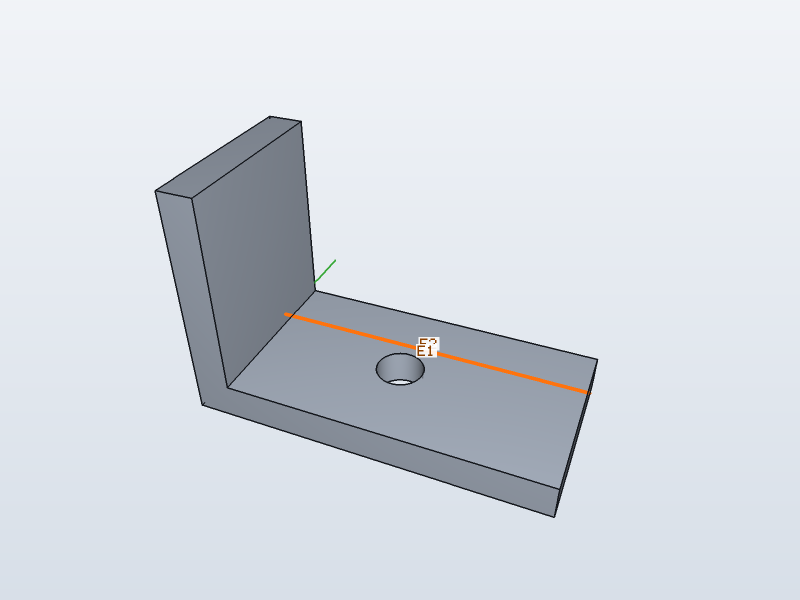

# Rolidium as an MCP server

`rolidium mcp` lets an AI client (Claude Code, Claude Desktop or any other client of the Model Context Protocol) build, inspect and
export a model **without a window**. It is part of the public core of Rolidium and is in both packages (Linux and Windows).

## One program, three modes

The package holds a single program, `rolidium`, with three modes: the window (default), `rolidium cli ...` (scripts, benchmarks) and
`rolidium mcp ...` (this server). A copy or a link named `rolidium-cli` or `rolidium-mcp` behaves like the mode of that name (the Linux package
contains such links). The MCP mode starts before anything else of the program and never prints anything but protocol messages to
standard output, which is what a client needs. On Windows the program is a window program; the command-line modes attach to the console
they were started from, and when a client starts the server with pipes, the pipes are used as they are.

All modes share the **table of commands** (`crates/rolidium-cli/src/spec.rs`), which is the single source of
truth: every row gives the script word of `rolidium cli`, the name of the MCP tool, a description written for a language model, the
parameters with type, unit and range, and how the parameters are written in a script line. A tool call is turned into such a line and run
by the very same `Runner::run_line` that runs scripts, and the JSON schema of every tool is generated from its row. A test checks that
every row has a handler, that every script command is in the table, and that the example lines run.

## What it speaks

JSON-RPC 2.0 over standard input and output, one message per line (the stdio transport of the specification), written by hand
(no library: the protocol is small and this keeps the licence check trivial). The server answers both eras of the protocol that
exist at the time of writing: the revision with the `initialize` handshake (2025-11-25 and older, the server answers with the version
the client asked for, or 2025-11-25) and the revision 2026-07-28 with `server/discover` and the version in the `_meta` of every request
(results then carry `resultType: "complete"`; an unknown version gets error -32022 with the list of supported ones). It handles `ping`,
`tools/list` and `tools/call`; a tool that fails returns `isError: true` with an explanation, an unknown tool or bad request is a JSON-RPC error
(-32602, -32601, -32700). Batches are not supported. Every tool has an input schema and annotations (`readOnlyHint`, ...). Pictures come back as
`image` content (base64 PNG).

## Starting it and adding it to a client

    rolidium mcp --root /home/me/models [--timeout 120]

* `--root DIR` — the only directory the server reads files from and writes files to. A path is joined to it; `..`, absolute paths
  elsewhere and symbolic links pointing out are refused. Without `--root` all file tools are refused.
* `--timeout SECONDS` — the time limit of one operation (default 120). A slower one is cancelled (the cancellable calculation of the
  kernel), the model stays unchanged and the answer says so.

The server holds **one document in memory** for as long as it runs; the state stays between calls. There is no network access and no
command is ever run. Limits: a message line up to 8 MB, a file to open up to 200 MB, numbers inside the ranges in the schemas,
pictures up to 2048 x 2048.

The easy way: run `rolidium mcp-config` (add `--root DIR` to choose the folder). It prints ready-made commands for Claude Code and a JSON
configuration for other clients, with the real absolute path of the program where you unpacked it, so nothing has to be filled in.

Claude Code:

    claude mcp add rolidium -- /path/to/rolidium mcp --root /home/me/models

or in a project file `.mcp.json` / in the settings of Claude Desktop:

```json
{
  "mcpServers": {
    "rolidium": {
      "command": "/path/to/rolidium",
      "args": ["mcp", "--root", "/home/me/models"]
    }
  }
}
```

On Windows use `"command": "C:\\path\\to\\rolidium.exe"` (the same arguments).

## Threads

The server uses one thread per core less one for the calculations that can share the work (at least one). `ROLIDIUM_THREADS=2` (a number, or `auto`) changes that, for `rolidium mcp` and `rolidium cli` alike.

## The tools

| Tool | What it does |
| --- | --- |
| `new_document` | Start an empty document |
| `open_document` | Open a .rolidium file (a path under the root directory of the server) |
| `save_document` | Save the document as a .rolidium file under the root directory |
| `import_stl` | Import an STL file (binary or ASCII) as a mesh, with units (mm, `inch`, `scale k`); answers with the size and the check of the mesh |
| `mesh_info` | Triangles, size and volume of a mesh |
| `mesh_to_document` | Makes a mesh a body of the document (saved in the .rolidium file, exported with the solids) |
| `mesh_check` | Holes, normals that disagree, edges of more than two triangles, degenerate triangles, loose pieces |
| `mesh_repair` | Join duplicate vertices and turn the triangles so that neighbours agree about the outside |
| `mesh_regions` | Planar walls and round holes or pins of a mesh, numbered |
| `mesh_pull` | Pull a planar wall of a mesh along its normal; the neighbouring walls stretch (refused with the reason when it cannot be clean) |
| `mesh_hole` | Change the diameter of a round hole or pin of a mesh |
| `mesh_undo` | Undo the last mesh_pull or mesh_hole |
| `mesh_redo` | Redo what mesh_undo took back |
| `mesh_scale` | Scale a mesh by different factors in x, y and z |
| `mesh_move` | Move a mesh |
| `mesh_rotate` | Turn a mesh about x, y or z |
| `mesh_mirror` | Mirror a mesh in the plane of x, y or z |
| `mesh_pattern` | Repeat a mesh along a line (one mesh of count pieces) |
| `export_mesh_stl` | Write a mesh as an STL file |
| `mesh_save` | Save a mesh in the compact form of Rolidium |
| `mesh_open` | Open a mesh saved with mesh_save |
| `export_stl` | Write a body as a binary STL file (for 3D printing) |
| `export_step` | Write a body as a STEP file (for other CAD programs) |
| `import_step` | Add the solids of a STEP file as new bodies |
| `add_box` | Add a box (a body) with one corner at the origin and the opposite corner at (x, y, z) |
| `rename_body` | Change the name of a body (free text, may repeat) |
| `start_sketch` | Choose where the next sketch shapes (line, rect, circle, arc) are drawn: a base plane (xy, xz or yz, optionally moved along … |
| `sketch_line` | Draw a straight line in the current sketch |
| `sketch_axis` | Draw an auxiliary axis (dash-dotted, no region); `plane-of S N`, `axis-of S N`, `direction-of S N` use it in a mirror or a pattern |
| `move_feature` | Move a hole or a pin of a body by a shift, or to given distances from the two nearest edges |
| `sketch_rectangle` | Draw an axis-aligned rectangle in the current sketch from one corner to the opposite one (a closed region) |
| `sketch_circle` | Draw a circle in the current sketch (a closed region) |
| `sketch_arc` | Draw a circular arc in the current sketch through three points: start, a point on the arc, end |
| `list_regions` | List the closed regions of the current sketch (index, area in mm2, holes) |
| `pull_region` | Extrude a closed region of the current sketch along the normal of its plane by a distance (mm) |
| `pull_face` | Push or pull a flat face of a body along its normal by a distance (mm): positive grows the body outwards, negative cuts into it |
| `round_edges` | Round (fillet) edges with a radius in mm |
| `fill_loop` | Fill: make a region of the closed flat loop of edges an edge belongs to (the edge of a hole, the inner circle of a pipe); pull the region with `pull_region` to close the hole or make a plug |
| `join_ends` | Join ends: connect the free ends of open lines and arcs (or 3D lines) that are closer than a largest gap; tiny gaps are welded, larger ones get a line |
| `chamfer_edges` | Chamfer (bevel) edges: cut the corner by a distance in mm, or with an angle (a second distance = distance times tan(angle)) |
| `combine_bodies` | Combine bodies: merge (union) the tools into the target, cut (subtract) the tools from the target, or intersect (keep the … |
| `move_body` | Move a body by a vector (mm), or move a copy of it |
| `rotate_body` | Rotate a body about an axis parallel to X, Y or Z through the centre of its bounding box (or through a given pivot), by an … |
| `delete_item` | Delete a body, a sketch or a curve by its number (as listed by describe_model) |
| `add_3d_line` | Add a 3D line (a path, not a body) through points x y z; with a radius the corners are rounded |
| `add_helix` | Add a helix (a path, not a body): a spiral about an axis, for springs and threads |
| `sweep_along_path` | Sweep a closed region of the current sketch along a path: a 3D line / helix from add_3d_line / add_helix (curve number), or a … |
| `loft_profiles` | Join the first closed region of every sketch, in the order the sketches were made, into one body (ruled = straight between … |
| `revolve_region` | Revolve a closed region of the current sketch about an axis through the origin parallel to X, Y or Z (in the coordinates of … |
| `measure` | Measure the distance (and angle, parallel-face distance, axes distance where they apply) between two elements of a body |
| `set_material` | Set the material of a body, which decides its mass: steel, aluminium, brass, copper, PLA, PETG, ABS, or a density in g/cm3 |
| `mass` | Report the mass (g) of every body from its volume and material |
| `linear_pattern` | Make a pattern of a body along a straight line (a link): the body and copies at a spacing, also as a grid, or added to or cut out of another body (a row of holes from one cylinder) |
| `repeat_feature` | Repeat a hole or a pin of a body in the same body: a row (also with the second piece at a point), round an axis, a mirror, into the four corners or a grid of a flat rectangular face (a link; a hidden tool body is made from the round faces) |
| `circular_pattern` | Make a pattern of a body round an axis (a link): copies turned by an angle one after another, or spread evenly round the whole circle |
| `mirror_body` | Mirror a body in a plane: in place, keeping the original, merged with it into one symmetric body, or as a live link that follows the original |
| `shell_body` | Make a body hollow (a link): wall thickness, the flat faces that are taken away (x+, x-, y+, y-, z+, z-), inwards, outwards or both ways; text, holes and pins thinner than the wall are taken off and put back |
| `add_text` | Put text on a flat face of a body (a link): the words, the place, the normal, the height of the capitals, the depth, raised or engraved, one of four bundled fonts, bold, italic, alignment |
| `list_links` | List the links (patterns and mirrors) with their parameters, source bodies and the bodies they made |
| `edit_link` | Change a link (number of pieces, spacing, angle, mirror plane, name) and calculate it again |
| `unlink` | Remove a link; the bodies it made stay as ordinary bodies |
| `delete_link` | Remove a link and what it made |
| `group_bodies` | Put bodies into a new group (groups nest, and are hidden, shown and renamed as a whole) |
| `list_groups` | List the groups with their bodies |
| `move_to_group` | Move bodies into a group, or out of every group |
| `ungroup` | Dissolve a group: its bodies and groups go one level up |
| `sketch_pattern` | Repeat the shapes of the current sketch along a line or round a point (the new shapes make regions that can be pulled together) |
| `sketch_mirror` | Mirror the shapes of the current sketch in a line |
| `undo` | Undo the last change of the model |
| `redo` | Redo the change that was undone |
| `describe_model` | Describe the whole model with the numbers and ids other tools refer to: bodies (number, volume, mass, bounding box, faces with … |
| `select_geometry` | Find faces or edges of a body by a query and return their ids and geometry, for example the highest face looking up (`kind … |
| `render_view` | Draw the model to a PNG picture and return it as an image |

Units are millimetres and degrees; Z is up. Bodies, sketches and curves are numbered from 1 (as `describe_model` lists them), faces and edges
by the ids `describe_model` and `select_geometry` return. A circle is given by its **diameter**.

Sketch coordinates: on `xy` the sketch x is X and y is Y; on `xz` x is X and y is Z (the plane looks along -Y, so material is pulled
towards -Y with a positive distance); on `yz` x is Y and y is Z. For a sketch on a face, `start_sketch` answers with where the sketch point (0, 0)
is and where the sketch x and y axes point in the model, so the next coordinates can be computed.

`describe_model` returns bodies (volume, mass, bounding box, faces with kind, area, centre and normal or axis, edges with length, ends, centre of
circles and the faces they join), sketches (with their regions) and curves. `select_geometry` finds faces or edges by a query, for example the
highest face looking up (`kind face`, `normal +z`, `extreme +z`), the edges of a face (`kind edge`, `of_face 3`) or all cylindrical faces.
`render_view` draws a PNG with the built-in software renderer (so it works on a machine without a graphics card): standard or custom
view, size, and optionally highlighted faces and edges labelled with their ids (F12, E5).

## Errors

Every failure leaves the model unchanged and says what to try, for example: *"The radius of 50 mm does not fit these edges … What to try: A radius or chamfer of
this size does not fit those edges. Try a smaller value (for example half of it)."* Combine checks its own result: the volume of a merge must be at
least the larger input and at most the sum, of a cut at most the target, of an intersection at most the smaller body, and the result is compared with
an independent calculation (see `docs/DECISIONS.md` D30). The message "the bodies do not touch or overlap" is given only when they really are apart.

## A sample session

An angle bracket with a hole, from an empty document to an STL file and a picture
(`tools/call` arguments only; the answers are abridged):

    start_sketch {"on": "xz"}
    sketch_line {"x1": 0, "y1": 0, "x2": 60, "y2": 0}        … six lines draw the L profile (0,0) (60,0) (60,6) (6,6) (6,40) (0,40)
    pull_region {"region": 0, "distance": 30}                  -> volume 16920.000 mm3, 1 body
    select_geometry {"kind": "face", "normal": "+z"}           -> the face with id 2 is the top of the base (centre z = 6)
    start_sketch {"on": "#2"}                                  -> sketch point (0, 0) is at (0, 0, 6), x axis = (1, 0, 0), y axis = (0, 1, 0)
    sketch_circle {"cx": 30, "cy": -15, "diameter": 8}
    pull_region {"region": 0, "distance": -6, "mode": "cut"}   -> volume 16618.407 mm3 (the hole removed 301.593 mm3)
    round_edges {"size": 2, "edges": [1]}
    render_view {"view": "iso", "highlight_faces": [2]}        -> an image
    export_stl {"path": "bracket.stl"}                         -> wrote bracket.stl (384 triangles)



## Later

Connecting the server to a **running window**, so that the user sees the changes live, is planned (see `docs/ROADMAP.md`).
