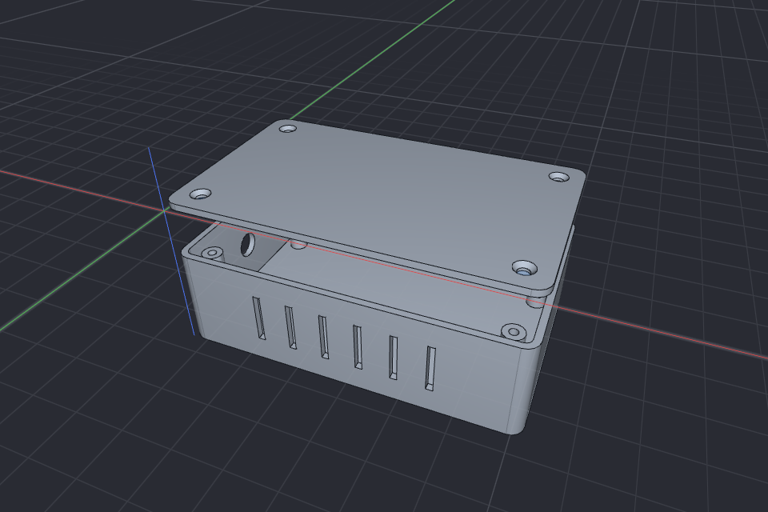

# 01 Electronics box with a lid

A box for a small circuit board with a screw-on lid, the lid lifted 15 mm above the box so that the inside can be seen.

* **Size:** 100 x 60 x 30 mm, wall 2 mm, the four vertical edges rounded R4 outside and R2 inside.
* **Details:** four screw posts (diameter 6, hole 2.5 for M3), six vent slots 2 x 15 mm in the long wall, a cable hole of diameter 8 in the end wall.
  The lid is 2 mm thick with a lip 1.5 mm high that fits the cavity with 0.2 mm clearance on each side, and four holes of 3.2 mm, countersunk.
* **Bodies:** 2 (box, lid). **Volume:** 43 749.262 mm3 (box 31 341.582 + lid 12 407.680).
* **Tools:** Box, Sketch (Rectangle, Circle), Pull (add and cut), Round, Chamfer.
* **Files:** `build.py` writes `build.txt`, which `rolidium cli run build.txt` runs.
