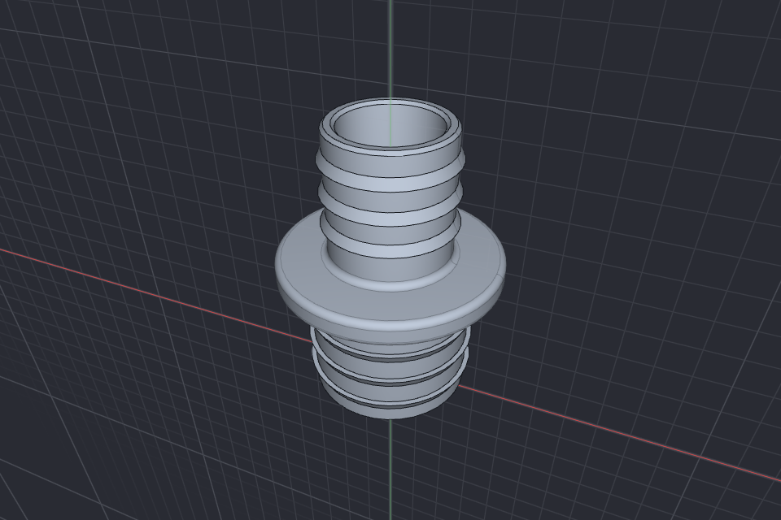

# 02 Hose adapter

A turned adapter between two hoses, drawn as one half section and revolved.

* **Size:** 90 mm long. A collar of diameter 70 and 8 mm wide in the middle; nipple A (outer diameter 50, 41 mm long, bore 42) and
  nipple B (outer diameter 38, 41 mm long, bore 30) with a smooth conical transition inside. Three barbs on each nipple (ramps that stop a
  hose from sliding off), the mouths chamfered 1 mm, the transitions rounded R2.
* **Bodies:** 1. **Volume:** 65 994.352 mm3.
* **Tools:** Sketch (Line), Revolve, Round. A half of the part is cut away for the section picture (Combine, cut).
* **Files:** `build.py` writes `build.txt`; `outputs.txt` adds the STL and the section picture.
