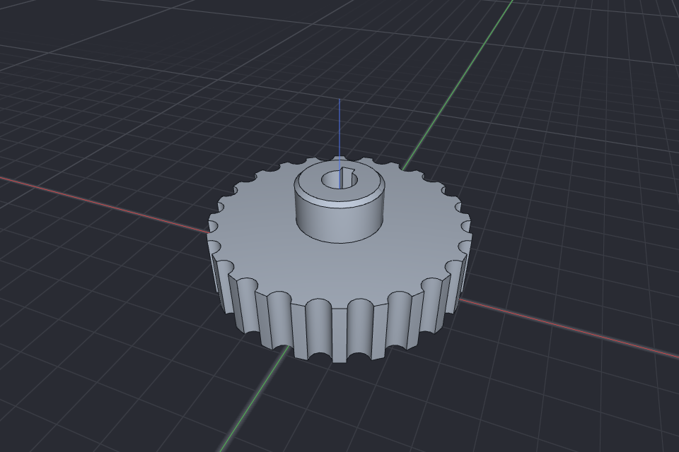

# 03 Knurled knob

A hand knob for a shaft of 8 mm.

* **Size:** diameter 60, 15 mm thick. 24 half-round grooves of radius 2.5 around the rim. A hub of diameter 20 stands 10 mm out of the top.
  Bore of 8 mm with a keyway 3 mm wide and 1.4 mm deep; a shallow round recess of diameter 44 in the front; the hub and the recess are chamfered 1 mm.
* **Bodies:** 1. **Volume:** 38 413.327 mm3. Suitable for 3D printing (an STL is made).
* **Tools:** Sketch (Circle, Rectangle), Pull (add and cut), Chamfer.
* **Left out:** the chamfer of the scalloped rim. The Chamfer tool takes the edges one at a time, and the rim is a chain of 48 arcs.
