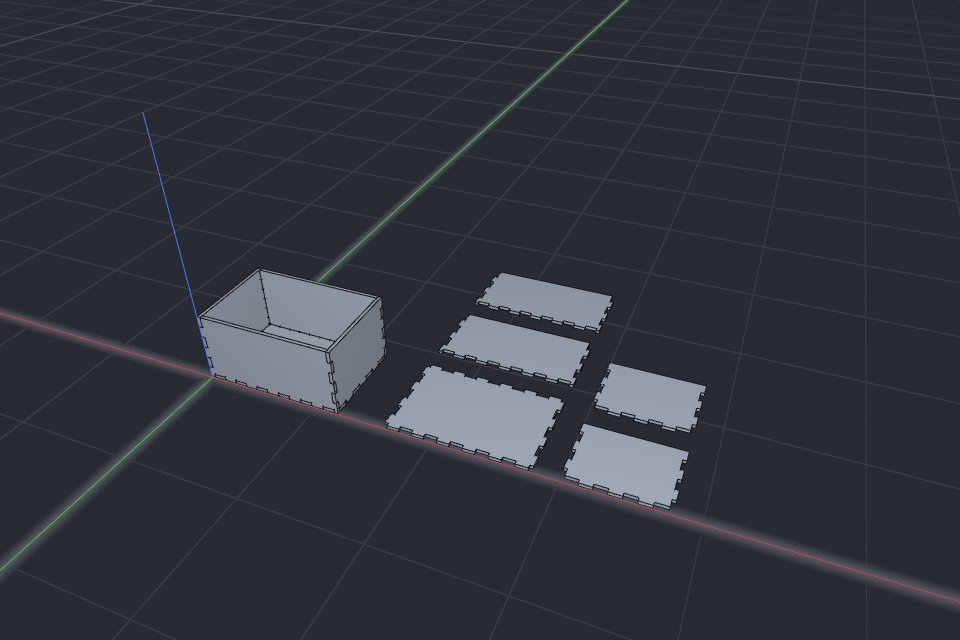

# 04 Finger-joint box for a laser cutter

A box without a lid, made of five plates of 3 mm material that are joined by fingers. The file holds it twice: folded up, and next to it the
same five plates laid flat in the XY plane, the way they would go under the laser.

* **Size:** 120 x 80 x 60 mm outside. The fingers on the vertical edges are exactly 10 mm (six per edge); on the bottom edges they are
  10.36 mm (along the 120 mm sides, 11 parts) and 10.57 mm (along the 80 mm sides, 7 parts), because the length between the corner
  columns is not a multiple of 10.
* **Bodies:** 10 (5 flat plates and 5 folded). **Volume:** 190 296.002 mm3 (the folded plates and the flat plates are the same, 95 148.001 each).
* **Checked by the test:** in the folded state no two plates share any volume (the common volume of every pair of plates that could meet is zero).
* **Tools:** Sketch (Rectangle), Pull (add and cut), Move and Rotate with copy.
* **Notes:** a slot that touches another slot cannot be cut from one sketch (the shared edges confuse the regions), so every slot has its own sketch.
  The plates are copied, turned and moved into place because plates that touch would be joined into one body by Pull.
