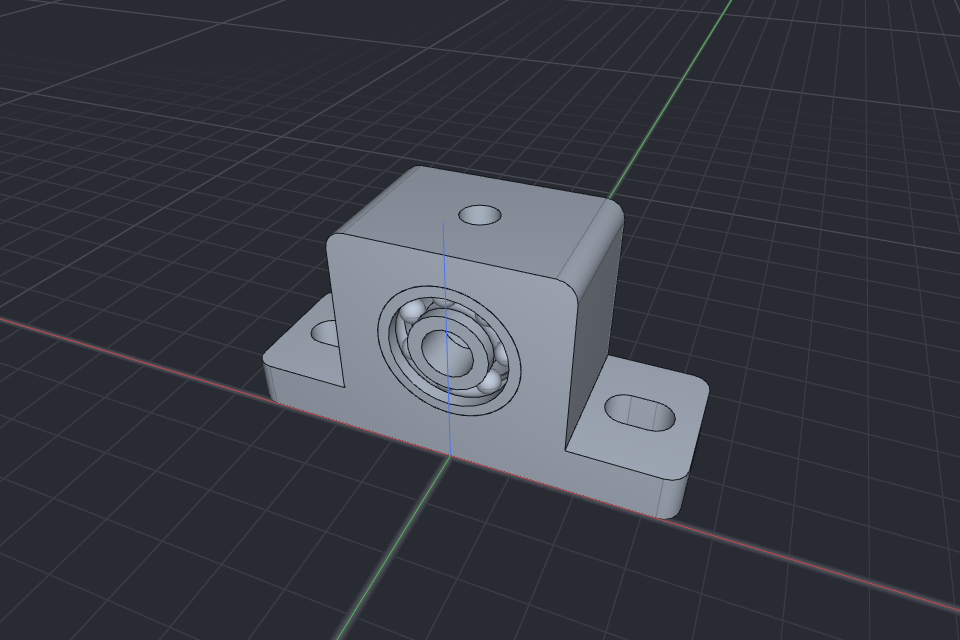

# 05 Pillow block with a ball bearing

A pillow block housing and a bearing of the size 608 (8 x 22 x 7 mm) in its seat, with the rings, the raceways and seven balls.

* **Bearing:** inner ring (bore 8, outer 12.5) and outer ring (outer 22, inner 18.5), each with a raceway groove drawn as an arc and revolved;
  seven balls of 3.969 mm on a pitch circle of 15.5 mm. No cage (the program cannot make a shape that fine without a loft).
* **Housing:** base 70 x 24 x 8 with two oval slots for M6 screws, 52 mm apart; the block over the axis (axis height 20 mm); a bore of 19 and a seat of 22.05
  (0.025 mm clearance) 7 mm deep; a lubrication hole of 6 at the top; rounds R3.
* **Bodies:** 10 (housing, 2 rings, 7 balls). **Volume:** 30 240.269 mm3. No two bodies share volume (checked by the test).
* **Section:** the program has no section view, so the file `05-bearing-block-section.rolidium` has half of every body (x > 0) cut away; the detail picture is made from it.
  (A half and not a quarter: seen from the side, a quarter would still hide the cut face.)
* **Tools:** Sketch (Line, Arc, Circle), Revolve, Pull (add and cut), Round, Move with copy, Combine (cut with keep).
* **How it is built:** by `parts.bearing_block` (the machine, demo 10, uses it too). The housing is built far away; the rings and balls are revolved about an axis through the origin (Revolve turns about an axis through the origin, so that place has to be empty), then everything is moved to its place (a move never joins bodies).
