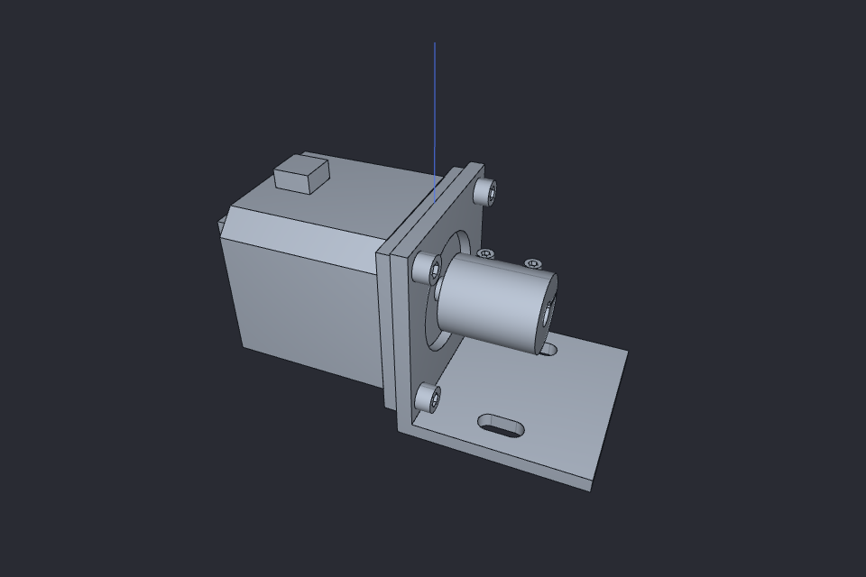

# 06 NEMA 23 stepper motor with a bracket and a coupling

A stepper motor of the size NEMA 23 with its angle bracket, a clamp coupling on the shaft and the screws, assembled with the shaft along +X.

* **Motor:** flange 56.4 x 56.4 x 5 with four blind holes of 5 mm on a pitch of 47.14 mm, a pilot of 38.1 x 1.6, a body of 55.6 x 55.6 (56 mm long, corners chamfered 7 mm),
  a rear cap, a cable box, a shaft of 8 x 21 with a flat (drawn 7.98 mm thick so that it does not touch a bore of 8).
* **Bracket:** an angle of 5 mm plate, 60 wide: the plate 65 mm high (a 60 mm leg would let the screw heads touch the foot), the foot 60 mm long; a hole of 38.5 for the pilot,
  four holes of 5.5, two oval slots in the foot.
* **Coupling:** diameter 25, 30 long, two bores of 8, a slit of 1 mm, two M3 screws (drawn simplified: a cylindrical head with a hex socket, a smooth shank, 2.9 mm thick).
* **Screws:** four M5 (head 8.5 x 5, hex socket 4, shank 4.9) from the front of the plate into the flange.
* **Bodies:** 9. **Volume:** 225 089.134 mm3. No two bodies share volume (checked by the test; it found an overlap between a screw head and the foot of the first version of the bracket).
* **Tools:** Sketch, Pull (add and cut), Chamfer, Move (also with copy), all through `parts.py` and `rdm.py`, which write the script.
* **How it is built:** every part is built far away (the staging area) and moved in, because parts that touch are joined into one body by Pull.
