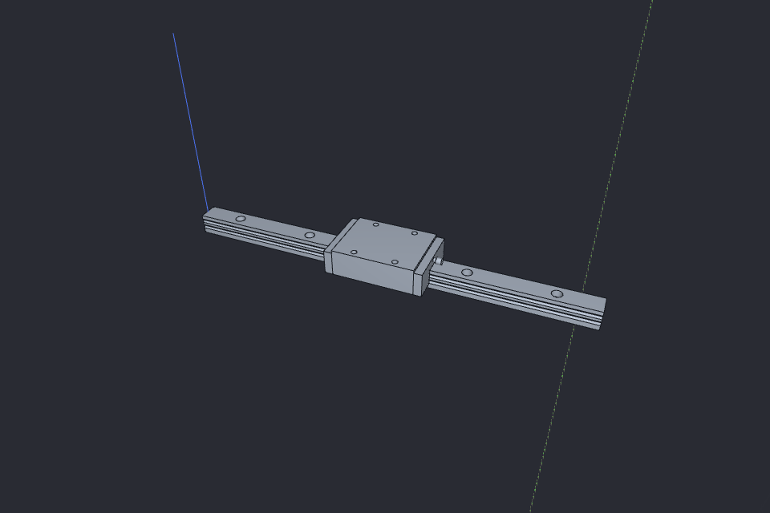

# 07 Linear guide with a carriage

A profiled rail of the size 15 with a carriage, two end caps and a grease nipple.

* **Rail:** 15 x 15, 300 mm long, a general profile with two ball grooves on each side (drawn once, extruded), five counterbored holes (4.5 through, 7.5 x 5.3 deep) every 60 mm.
* **Carriage:** 47 wide, 60 long, 24 above the foot of the rail, a channel that clears the rail by 0.1 mm everywhere (also in the grooves), four holes of 4.2 for M5 on 38 x 30.
  Two end caps (47 x 22 x 6) and a grease nipple.
* **Bodies:** 5. **Volume:** 117 533.047 mm3. No two bodies share volume (checked by the test; the carriage and the rail do not touch, the caps touch the carriage with a face).
* **Left out:** the balls and the recirculation tracks inside the carriage: the grooves of the carriage are there, the balls are not.
* **Tools:** Sketch (Line, Circle), Pull (add and cut), Move. The script is written by `parts.py` (`linear_rail`, `carriage`, `end_cap`, `grease_nipple`), which the machine (demo 10) uses too.
