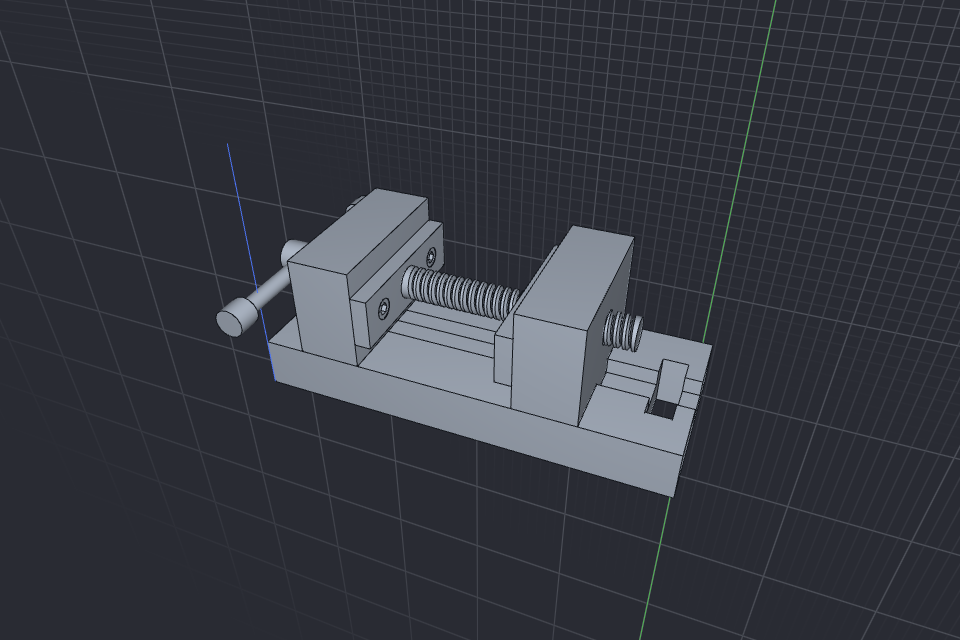

# 08 Machine vise

A vise for a milling machine with a lead screw that has a real thread.

* **Base:** 200 x 80 x 25 with a guide groove (20 x 8) along the whole length and two clamping slots of 12 x 40.
* **Jaws:** a fixed and a moving jaw (30 x 80 x 50), each with a replaceable insert of 80 x 25 x 8 on two screws (head 10 x 6 sunk in a counterbore).
  The moving jaw has a tongue in the guide (0.1 mm clearance) and a pocket for the nut. The jaws are open 60 mm.
* **Screw:** 16 x 180, a thread of pitch 4 over 108 mm (a trapezoid groove of 27 turns swept along a helix and subtracted: **the kernel did it
  reliably, 3 s for 195 faces**), a cross hole for the crank. **Nut** in the moving jaw (the thread of the nut is not drawn: a smooth bore of 16.1).
* **Crank:** a bar of 8 x 100 through the screw and two end pieces of 14 x 12.
* **Bodies:** 14. **Volume:** 648 097.941 mm3. No two bodies share volume (checked by the test).
* **Left out:** the threads of the small screws and of the nut, the fixing of the fixed jaw to the base.
* **Tools:** Box, Sketch, Pull (add and cut), Helix, Sweep (cut), Rotate, Move with copy. The test of this demo is among the slow ones (`--ignored`).
