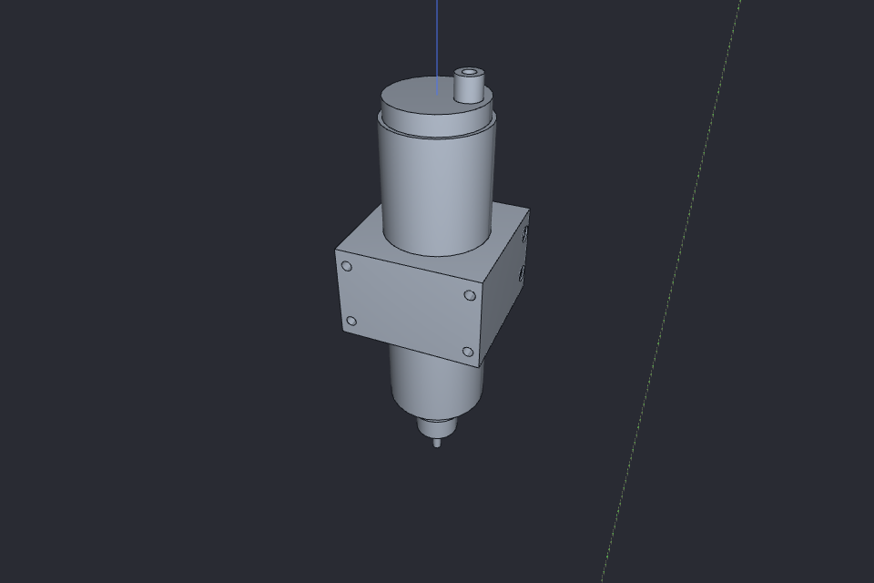

# 09 Router spindle with a clamp mount

A spindle for a CNC router, as it would be bolted to the Z axis: the housing, the tool and the clamp that holds it. The tool points down.

* **Spindle:** housing 65 x 200, a nose of 40 x 15 with a bore of 6.2, a collet nut 30 x 22, an end mill of 6 mm (a smooth cylinder, 55 long), a cap 60 x 12 on top with a cable gland 16 x 14.
* **Mount:** a block 90 x 90 x 60 with a clamping bore of 65.1, a slit of 1.5 mm, two M6 clamp screws across the slit (head 10 x 6 in a pocket, shank 5.8 x 70, the thread is not drawn),
  four holes of 6.6 to bolt it to the plate of the Z axis.
* **Bodies:** 8. **Volume:** 1 006 190.014 mm3. No two bodies share volume (checked by the test; the cutter and the bores, the mount and the housing clear each other by 0.1 to 0.2 mm).
* **Tools:** Sketch, Pull (add and cut), Move with copy. The parts are written by `parts.py` and used again in the machine (demo 10).
