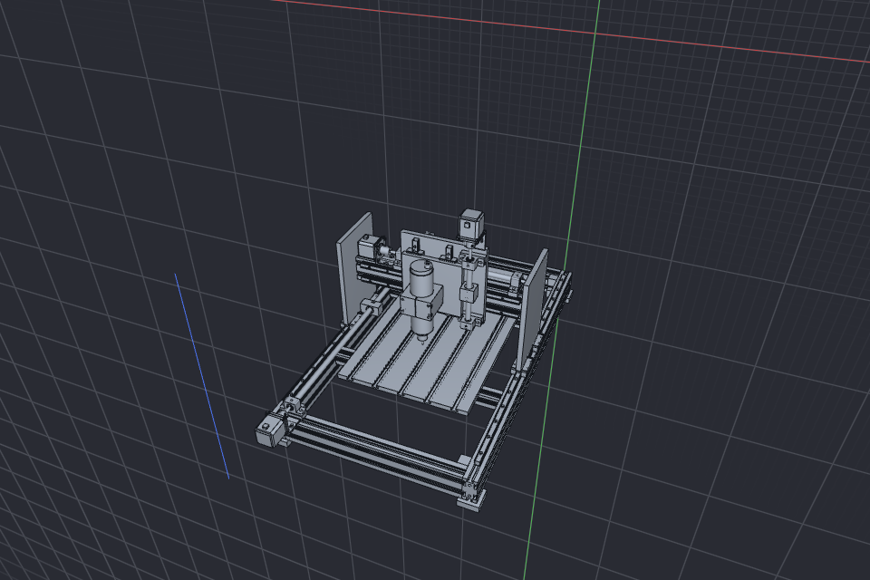

# 10 Gantry CNC router

A router with a work area of 600 x 400 mm, built from the parts of the demos before it. It is the stress test of the set: 188 bodies, 2318 script lines.

* **Frame:** two long profiles 40 x 80 x 1000, two end members 40 x 80 x 520, two middle members 40 x 40 x 520 (a T-slot section drawn once and extruded to each length),
  eight corner connectors, four feet. **Table:** a plate 400 x 600 x 15 with five T-slots.
* **Y axis (the portal moves):** two rails of size 15 (demo 7), four carriages with caps and nipples, a ball screw 16 x 920, two bearing blocks (demo 5), a NEMA 23 motor with bracket and
  coupling (demo 6), a nut with a holder. **Portal:** two side plates 15 mm and a cross beam 40 x 80.
* **X axis:** two rails on the cross beam, four carriages, the same screw, bearing blocks and drive. **Z axis:** the carrier plate, two rails, four carriages, the spindle plate, again the screw
  with its blocks and drive, 230 mm of rail (about 80 mm of travel at the spindle plate).
* **Spindle** with its clamp mount (demo 9). The portal is in the middle of its travel, the Z axis at the top.
* **Bodies:** 188. **Volume:** 20 324 348.795 mm3. **No two bodies share volume** (checked by the test: every pair whose boxes meet is tested; 0 overlaps).
* **Reuse:** the parts are the same Python functions as in demos 5 to 9 (`parts.py`), called with a frame (`rdm.Frame`) for each direction. Every part is built in an empty place and moved in, because Pull joins
  bodies that touch.
* **Left out / simplified:** ball screws and nuts have no thread, the carriages have no balls, no cables, no covers, no bolts for profiles and rails except those of the motors, couplings and bearing inserts. The
  holders of the nuts are plain blocks that touch the plates. The Z motor bracket rests against the front of the carrier plate along an edge only.
* **Slow demo:** the test of this demo is among the `ignored` ones (`cargo test -p rolidium-cli --test demos -- --ignored`).
