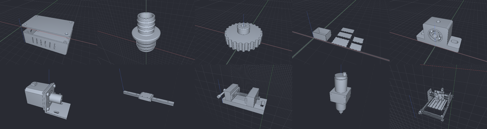

# Demo models

Ten models built only with the tools of Rolidium, by scripts for `rolidium cli`. They show what the program can do in this version, and they
are a test of it on bigger work than the unit tests. **They are made with the program as it is: where a tool is missing, the script works
around it (see the list at the end), and the pictures are what the program draws, nothing is touched up.**

| # | Model | Bodies | Shows |
| --- | --- | --- | --- |
| 01 | [Electronics box with a lid](01-electronics-box/) | 2 | sketches, pulls, cuts, rounds, countersinks |
| 02 | [Hose adapter](02-hose-adapter/) | 1 | revolve of a half section, barbs, a conical bore |
| 03 | [Knurled knob](03-knurled-knob/) | 1 | 24 grooves, keyway, recess, chamfers (3D printing) |
| 04 | [Finger-joint box](04-finger-joint-box/) | 10 | plates folded and laid flat, no overlaps |
| 05 | [Pillow block with a bearing](05-bearing-block/) | 10 | revolve, raceways, balls, a section file |
| 06 | [NEMA 23 motor with bracket and coupling](06-stepper-motor/) | 9 | an assembly built from shared parts |
| 07 | [Linear guide with a carriage](07-linear-guide/) | 5 | a drawn profile, 0.1 mm clearances |
| 08 | [Machine vise](08-machine-vise/) | 14 | a real thread by sweep along a helix |
| 09 | [Spindle with a clamp mount](09-spindle-mount/) | 8 | a clamp with a slit and screws |
| 10 | [Gantry CNC router](10-cnc-router/) | 188 | everything above, 188 bodies, no overlaps |

`rdm.py` and `parts.py` are the helpers that the `build.py` scripts use to write their scenarios (the parts of the middle row are used again in the machine); `montage.py` puts the previews side by side. Every folder has `build.py` (writes `build.txt`), `build.txt` (the scenario that the program runs), `README.md` (what it shows, sizes, volume)
and `preview.png`.

## Building them

    cargo build --release -p rolidium-app
    examples/demos/build-all.sh target/release/rolidium

The files go to `target/demos/NN-name/`: the model (`.rolidium`), STEP, pictures, and what `outputs.txt` of the demo asks for (STL for
printing, a detail picture). The test `cargo test -p rolidium-cli --test demos` builds the quick demos and checks the number of bodies and
the volume written in the header of every script, that every body is a valid closed solid, that bodies of an assembly share no volume, and
that the model survives a STEP round trip and a save and open. The slow demos are in a test marked `ignored`:
`cargo test -p rolidium-cli --test demos -- --ignored`.

## Licence

The models, their scripts, descriptions and pictures in this folder are released under **CC0 1.0** (public domain, see `LICENSE`).
The rest of the repository is under AGPL-3.0-only.

## What the demos lack (found while building them)

* Repeating along a line or a circle, groups of bodies, rotation about a point other than the body's own centre, copies of a group: every part is built in an
  empty place and moved, and copies are made body by body.
* Pull joins bodies that touch, so an assembly has to be built from parts that are moved into place (a move never joins).
* Colours, names of bodies, a section view, a view that is zoomed to a detail (the detail pictures show another side of the model, or a model with a half cut away).
* Revolve turns about an axis through the origin only, so the revolved parts are built there and moved.
* Sketch shapes with rounded corners, slots (the ovals are drawn from lines and arcs), polylines in one command.
